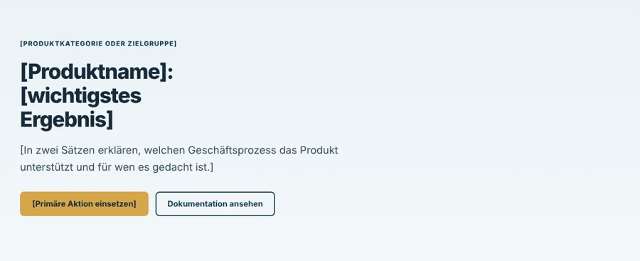
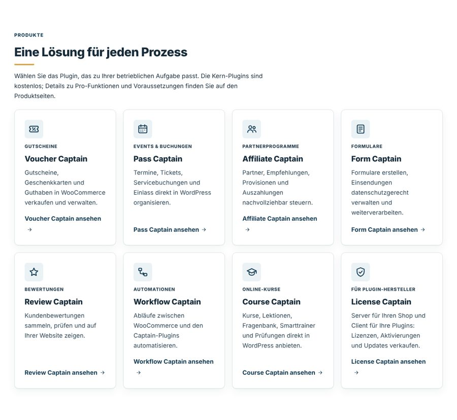
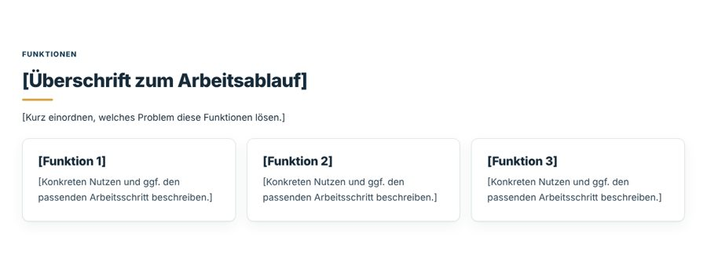
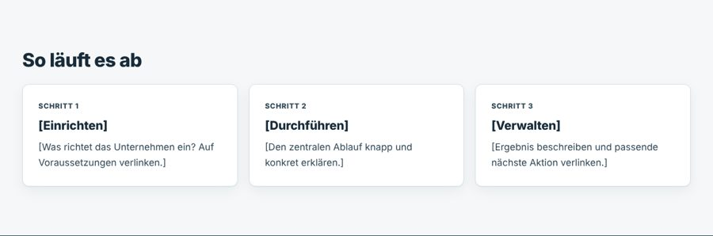
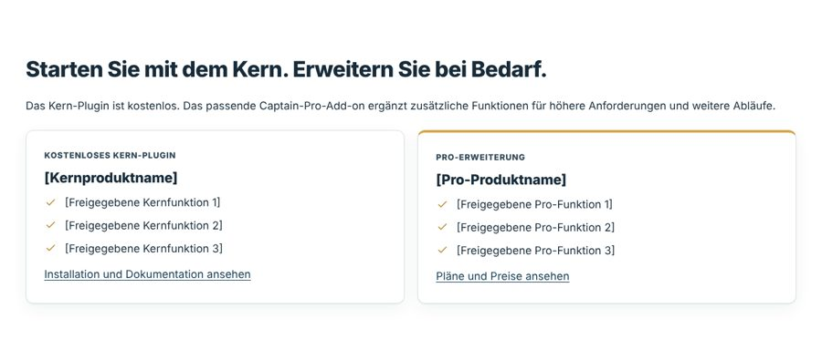
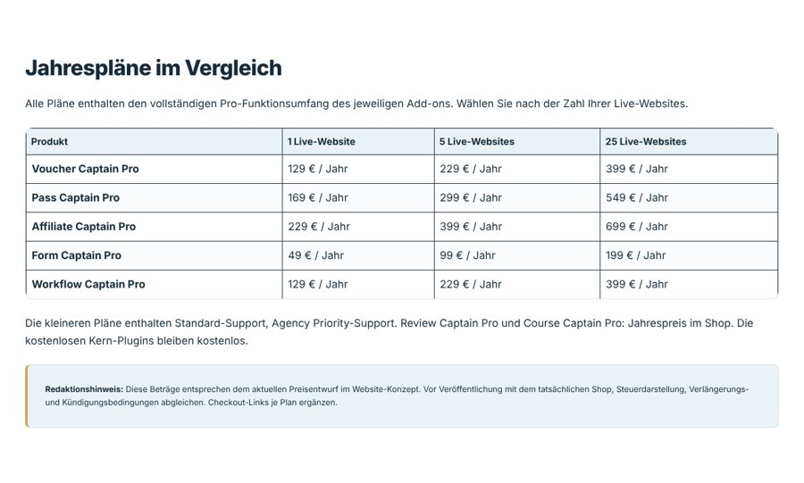
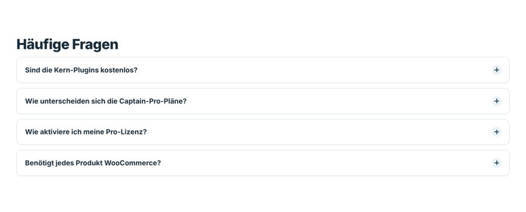
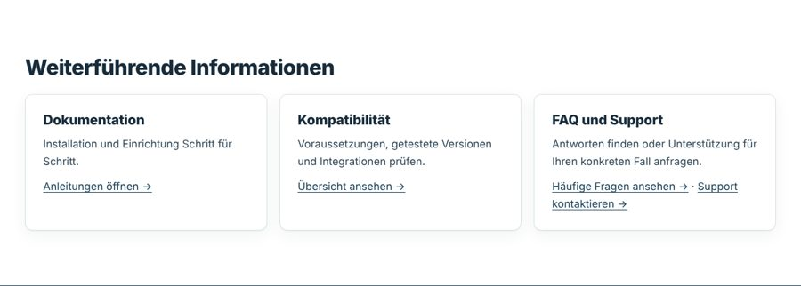
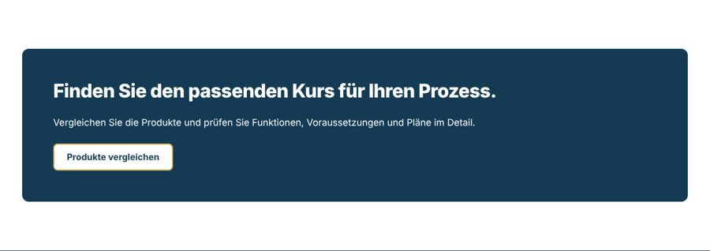

# Pattern-Katalog

Stand: 16. November 2026. Alle Block-Patterns des Themes finden Sie im Block-Editor unter **Patterns → Captain Plugins**. Farben, Abstände und Schriftgrößen kommen aus dem Designsystem und werden nicht pro Seite angepasst (siehe [Redaktionshandbuch](REDAKTION.md)). Texte in eckigen Klammern sind Pflichtfelder: Eine Seite mit offenen Klammern wird nicht veröffentlicht.

Vorschaubilder neu erzeugen: Patterns in einer Testinstallation auf je eine Seite setzen und den Inhaltsbereich abfotografieren (siehe Abschnitt am Ende).

| Pattern | Einsatz |
|---|---|
| [Startseite – Hero](#home-hero) | Startseite |
| [Produktseite – Hero](#product-hero) | Produkt-Startseiten |
| [Produktübersicht – Captain-Produktkarten](#product-cards) | Produktübersicht, Startseite |
| [Features – Nutzenkarten](#feature-grid) | Features-Seiten |
| [Arbeitsablauf – drei Schritte](#workflow) | Produkt- und Lösungsseiten |
| [Kostenlos und Pro – Vergleich](#free-pro) | Produkt- und Pro-Seiten |
| [Preise – Planvergleich](#pricing-comparison) | Preise, Captain Pro |
| [Medien – Screenshot-Platzhalter mit Briefing](#screenshot-brief) | überall, wo eine Produktansicht fehlt |
| [Voraussetzungen und Kompatibilität](#compatibility-note) | Produkt-, Installations- und Pro-Seiten |
| [FAQ – häufige Fragen](#faq) | FAQ-Seiten |
| [Ressourcen – Einstiegskarten](#resource-cards) | Doku, Support, Ratgeber |
| [Abschluss – Produkte vergleichen](#closing-cta) | Seitenende |

## Startseite – Hero

- **Slug:** `captain-plugins/home-hero`
- **Einsatz:** Startseite
- **Zweck:** Einstieg der Startseite mit Kernversprechen, zwei Handlungen und Kapitän (dekorativ).
- **Redaktion:** Überschrift, Einleitung, Button-Ziele prüfen.

## Produktseite – Hero

- **Slug:** `captain-plugins/product-hero`
- **Einsatz:** Produkt-Startseiten
- **Zweck:** Einstieg einer Produktseite: Zielgruppe, Produktname mit Ergebnis, Nutzen in zwei Sätzen, primäre und sekundäre Aktion.
- **Redaktion:** Alle Felder in eckigen Klammern; primäres Linkziel (Download/Checkout) eintragen.
- **Pflichtfelder:** `[Produktkategorie oder Zielgruppe]`; `[Produktname]`; `[wichtigstes Ergebnis]`; `[In zwei Sätzen erklären, welchen Geschäftsprozess das Produkt unterstützt und für wen es gedacht ist.]`; `[Primäre Aktion einsetzen]`

## Produktübersicht – Captain-Produktkarten

- **Slug:** `captain-plugins/product-cards`
- **Einsatz:** Produktübersicht, Startseite
- **Zweck:** Karten für alle acht Captain-Produkte mit Icon, Kategorie, Kurzbeschreibung und Link.
- **Redaktion:** Nur bei neuen Produkten anpassen; Reihenfolge: kostenlose Plugins, zuletzt License Captain.

## Features – Nutzenkarten

- **Slug:** `captain-plugins/feature-grid`
- **Einsatz:** Features-Seiten
- **Zweck:** Drei Nutzenkarten für priorisierte Funktionen.
- **Redaktion:** Überschrift, Einordnung und je Karte Funktion und Nutzen.
- **Pflichtfelder:** `[Überschrift zum Arbeitsablauf]`; `[Kurz einordnen, welches Problem diese Funktionen lösen.]`; `[Funktion 1]`; `[Konkreten Nutzen und ggf. den passenden Arbeitsschritt beschreiben.]`; `[Funktion 2]`; `[Funktion 3]`

## Arbeitsablauf – drei Schritte

- **Slug:** `captain-plugins/workflow`
- **Einsatz:** Produkt- und Lösungsseiten
- **Zweck:** Ablauf in drei Schritten (Einrichten, Durchführen, Verwalten).
- **Redaktion:** Schrittname und Beschreibung je Schritt.
- **Pflichtfelder:** `[Einrichten]`; `[Was richtet das Unternehmen ein? Auf Voraussetzungen verlinken.]`; `[Durchführen]`; `[Den zentralen Ablauf knapp und konkret erklären.]`; `[Verwalten]`; `[Ergebnis beschreiben und passende nächste Aktion verlinken.]`

## Kostenlos und Pro – Vergleich

- **Slug:** `captain-plugins/free-pro`
- **Einsatz:** Produkt- und Pro-Seiten
- **Zweck:** Gegenüberstellung kostenloser Kern und Pro-Add-on.
- **Redaktion:** Produktnamen und freigegebene Funktionen; License Captain nicht erwähnen.
- **Pflichtfelder:** `[Kernproduktname]`; `[Freigegebene Kernfunktion 1]`; `[Freigegebene Kernfunktion 2]`; `[Freigegebene Kernfunktion 3]`; `[Pro-Produktname]`; `[Freigegebene Pro-Funktion 1]`; `[Freigegebene Pro-Funktion 2]`; `[Freigegebene Pro-Funktion 3]`

## Preise – Planvergleich

- **Slug:** `captain-plugins/pricing-comparison`
- **Einsatz:** Preise, Captain Pro
- **Zweck:** Tabelle der Jahrespläne je Pro-Add-on mit Website-Limits und Redaktionshinweis.
- **Redaktion:** Preise vor Veröffentlichung mit dem Shop abgleichen; Redaktionshinweis danach entfernen.

## Medien – Screenshot-Platzhalter mit Briefing

- **Slug:** `captain-plugins/screenshot-brief`
- **Einsatz:** überall, wo eine Produktansicht fehlt
- **Zweck:** Platzhalterrahmen mit Aufnahmebriefing für einen echten Screenshot.
- **Redaktion:** Vor Veröffentlichung durch das freigegebene Bild ersetzen (siehe Medieninventar).
- **Pflichtfelder:** `[Benennen, was die Aufnahme zeigt]`; `[Welche Ansicht und welcher konkrete Arbeitsschritt sollen erkennbar sein? Beispieldaten verwenden, Personen- und Kundendaten entfernen und Browserrahmen nur zeigen, wenn er zum Verständnis beiträgt.]`

## Voraussetzungen und Kompatibilität

- **Slug:** `captain-plugins/compatibility-note`
- **Einsatz:** Produkt-, Installations- und Pro-Seiten
- **Zweck:** Hinweis auf Voraussetzungen mit Link zur Kompatibilitätsmatrix.
- **Redaktion:** Link prüfen; produktspezifische Mindestversionen ergänzen.

## FAQ – häufige Fragen

- **Slug:** `captain-plugins/faq`
- **Einsatz:** FAQ-Seiten
- **Zweck:** Fragen als native, per Tastatur bedienbare Aufklappelemente.
- **Redaktion:** Fragen und Antworten; wesentliche Kaufinformationen nicht nur im FAQ verstecken.

## Ressourcen – Einstiegskarten

- **Slug:** `captain-plugins/resource-cards`
- **Einsatz:** Doku, Support, Ratgeber
- **Zweck:** Einstiegskarten zu Dokumentation, Kompatibilität, FAQ und Support.
- **Redaktion:** Linkziele prüfen.

## Abschluss – Produkte vergleichen

- **Slug:** `captain-plugins/closing-cta`
- **Einsatz:** Seitenende
- **Zweck:** Abschlussband mit einer klaren nächsten Handlung.
- **Redaktion:** Überschrift, Satz und Button-Ziel.

## Vorschaubilder aktualisieren

1. In einer Testinstallation je Pattern eine Seite mit nur diesem Pattern anlegen.
2. Den Inhaltsbereich (`.cp-page-content`) bei 1280 px Breite abfotografieren und auf 900 px Breite als JPEG unter `docs/patterns/<slug>.jpg` speichern.
