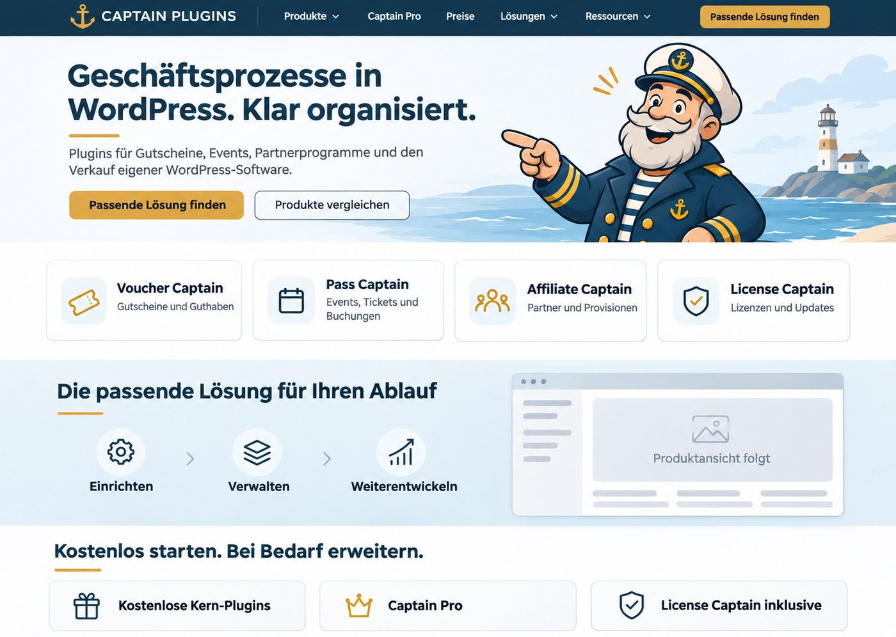
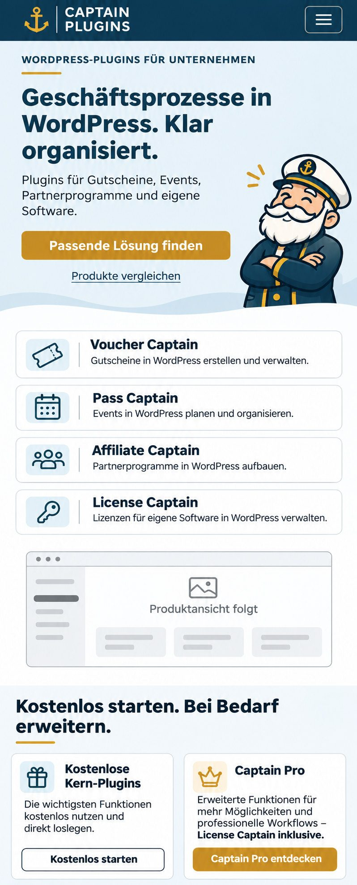
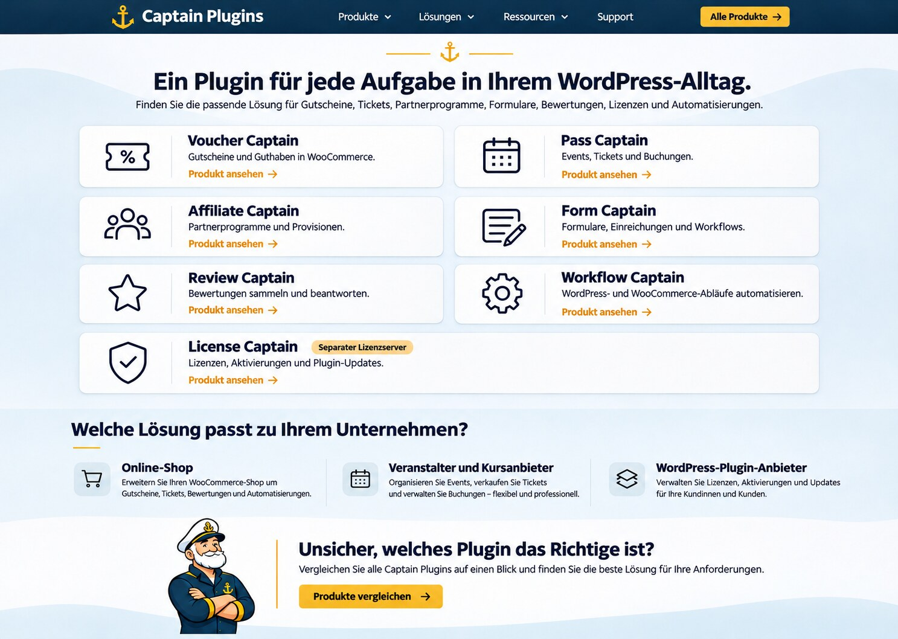
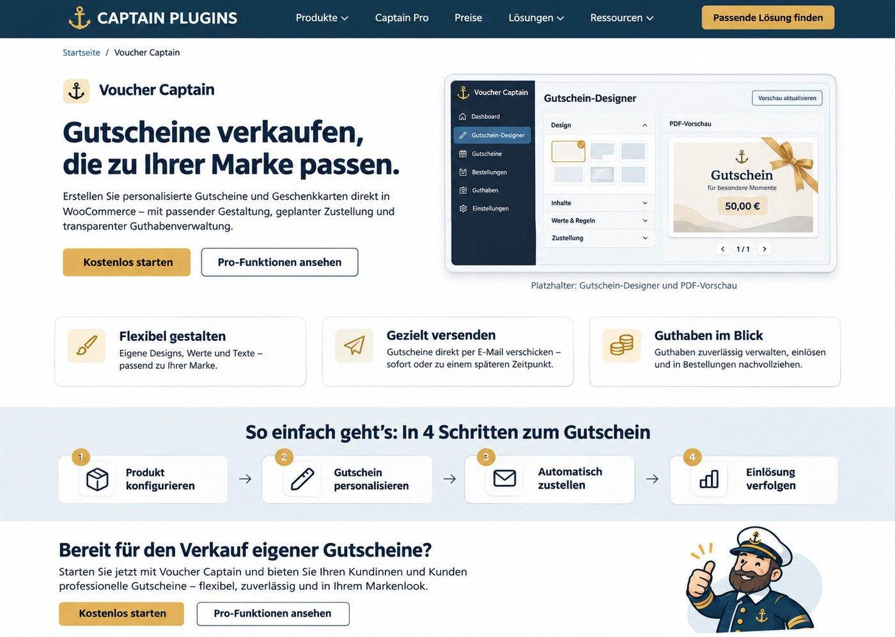
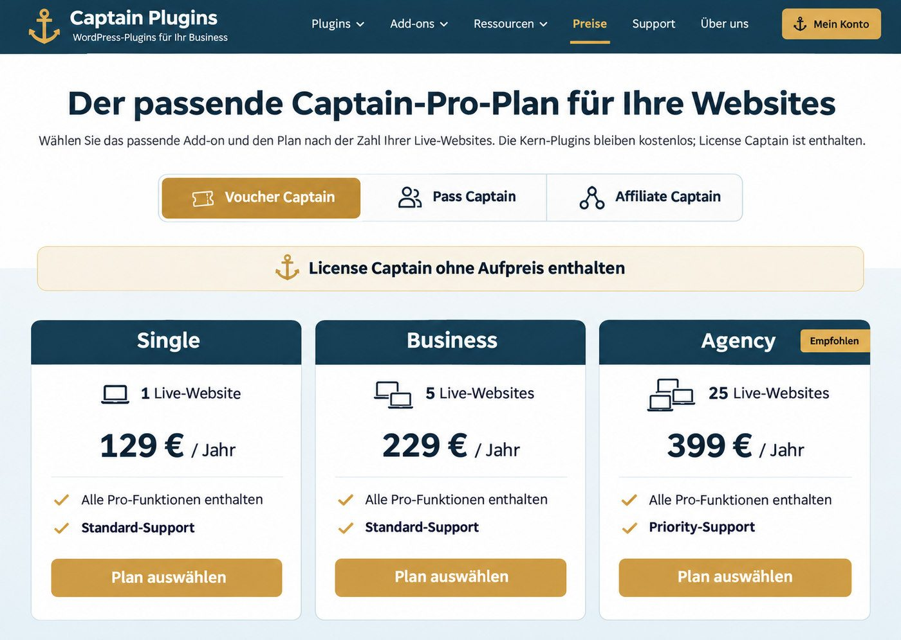

# Website-Umsetzungskonzept – Captain Plugins

**Stand:** 15. November 2026  
**Ziel:** Das vorhandene Text- und Produktkonzept in eine vollständige, umsetzbare Website-Struktur überführen. Dieses Dokument beschreibt Seiten, Navigation, Layout, mobile Verhalten, Bildsprache, Barrierefreiheit, CTAs, SEO und die technische Umsetzungsreihenfolge. Es ergänzt die Texte unter `texte/homepage/`; es ersetzt sie nicht.

## 1. Projektgrundlage und bereits vorhandene Arbeit

Das zentrale Redaktionskonzept liegt in [`texte/homepage/konzept.md`](texte/homepage/konzept.md). Es legt Positionierung, Produktumfang, Zielgruppen, Preise, Seitenintentionen und Yoast-Workflow fest. Die deutschsprachigen Entwürfe sind unter [`texte/homepage/README.md`](texte/homepage/README.md) verzeichnet: Startseite, Produktübersicht, Captain Pro, Preise, Vergleich, Integrationen, Kompatibilität, Support, Dokumentation, Bootsschulen-Lösung, Produktseiten, Features, Pro- bzw. Paket-Seiten, FAQs und Ratgeberartikel. Die bestehenden Entwürfe enthalten bereits beschriebene Platzhalter für Produkt-Screenshots, Demos und Kundenbeispiele.

Für die Umsetzungsplanung gelten dieselben Angebotsannahmen wie im Redaktionskonzept: Kern-Plugins sind kostenlos; Voucher, Pass, Affiliate, Form, Review und Workflow Captain Pro sind kostenpflichtig; License Captain ist ein eigenes Produkt aus Server und Client für Plugin-Hersteller. Unsere Pro-Add-ons werden intern darüber lizenziert (der Client steckt unsichtbar im Pro-Plugin); gegenüber Pro-Kunden wird License Captain nicht erwähnt. Pro-Preise werden vorläufig aus [`texte/homepage/preise.md`](texte/homepage/preise.md) übernommen; License-Captain-Preise stammen aus dem eigenen Shopkatalog.

### Bildmaterial im Repository

Im Ordner [`design/mascot/`](design/mascot/) liegen acht JPEG-Dateien:

- `image (2).jpg`
- `image_10fff423.jpg`
- `image_7c64ba2.jpg`
- `image_bb1a49cf.jpg`
- `image_c8ec0df9.jpg`
- `image_ca6d56e0.jpg`
- `image_f51356ee.jpg`
- `image_faa87147.jpg`

Das vorhandene Motiv zeigt einen gezeichneten Kapitän in mehreren Posen, darunter Zeigen, Daumen hoch, WordPress-Tablet und Fernrohr. Die Figur kann die Marke wiedererkennbar machen. Sie ist eine illustrative Ergänzung; sie ersetzt keine Produktansichten. Die Bilddateien sind vor dem Einsatz einzeln zu sichten und auf Format, Auflösung, Zuschnitt, Lizenz/Urheberschaft und sinnvollen Alternativtext zu prüfen. Das aktuelle Repository enthält keine belastbare Sammlung fertiger UI-Screenshots oder Kundenreferenzen. Deshalb bleiben die vorhandenen, erklärenden Screenshot- und Demo-Platzhalter in den Texten bestehen, bis echte Aufnahmen freigegeben sind.

**Bildbriefings für später einzusetzende Produktaufnahmen:**

| Produkt | Benötigtes Motiv | Was sichtbar sein soll | Datenschutz / Hinweis |
|---|---|---|---|
| Voucher Captain | Gutschein-Designer und Vorschau | Vorlagen, Empfängertext, QR-/Barcode und fertige PDF-Vorschau | Nur Testdaten und fiktive Empfänger verwenden |
| Pass Captain | Eventablauf und Einlass | Veranstaltung, Ticketansicht, Scannerstatus und Teilnehmerübersicht | Namen, E-Mail-Adressen und Bestellnummern unkenntlich machen |
| Affiliate Captain | Provision und Auszahlung | Partnerportal, Regelübersicht, nachvollziehbarer Auszahlungslauf | Keine realen Partner- oder Bankdaten |
| Workflow Captain | Workflow-Builder und Run-Protokoll | Trigger, Bedingungen, Providerstatus und redigierte Runs | Keine echten Kundendaten, Tokens oder Secrets |
| License Captain | Kunden-Lizenzbereich | Lizenzstatus, Aktivierungen und Produkt-Changelog | Keine echten Lizenzschlüssel oder Domains |
| Captain Pro | Planvergleich | Single, Business und Agency mit Website-Limits | Preise mit Shop-Checkout abgleichen |

## 2. Marken- und Gestaltungsrichtung

Die Website soll wie eine professionelle B2B-Softwaremarke wirken: klar, ruhig und funktionsorientiert. Die Kapitänsfigur gibt der Produktfamilie Persönlichkeit; typografische Klarheit, nachvollziehbare Produktabläufe und echte UI-Aufnahmen bilden die Hauptbelege.

### Visuelle Leitlinien

- **Gestaltungsprinzip:** großzügige Abstände, klare Überschriften, gut scannbare Abschnitte, wenig dekorative Effekte.
- **Farbansatz:** tiefes Marineblau als Markenanker, helle Flächen für Lesbarkeit, neutraler Textton und ein warmer Akzentton für interaktive Elemente. Konkrete Werte erst nach Prüfung vorhandener Logos und Bildfarben als Design-Tokens festlegen.
- **Produktunterscheidung:** gleiche Layoutlogik und Komponenten, aber je Produkt ein eigener Akzent (Voucher, Pass, Affiliate, Form, Review, Workflow und License), der auch mit Text/Icon erkennbar ist. Farbe allein darf die Zuordnung nicht vermitteln.
- **Schrift:** gut lesbare Sans-Serif für Fließtext und UI. Überschriften klar gestaffelt; Fließtext nicht zu schmal oder zu klein.
- **Icons:** einheitlicher Satz, mit sichtbaren Beschriftungen, wenn das Symbol nicht selbsterklärend ist.
- **Maskottchen:** punktuell einsetzen, nicht in jeder Sektion. Geeignete Stellen sind ein freundlicher Einstieg, erklärende Zwischenabschnitte und ein abschließender CTA. Bei kommerziellen Produktseiten bleibt die jeweilige Oberfläche das primäre Visual.
- **Keine falschen Beweise:** keine erfundenen Logos, Rezensionen, Zahlen, Awards oder Kundenfälle. Platzhalter klar als solche markieren und vor Veröffentlichung ersetzen oder entfernen.

### Wiederverwendbare Komponenten

1. Hauptnavigation mit Desktop-Mega-Menü und mobiler Navigation.
2. Breadcrumbs für Produkt-Unterseiten und Ratgeber.
3. Hero mit Eyebrow/Produktlabel, H1, Nutzenbeschreibung, ein bis zwei CTAs und optionalem Visual.
4. Produktkarte mit Kurzproblem, Nutzen, kostenloser Kern/Pro-Kennzeichnung und Link.
5. Feature-Karte mit Nutzenüberschrift, kurzer Erklärung und optionalem UI-Bildausschnitt.
6. Schrittfolge/Workflow mit nummerierten Schritten.
7. Free-/Pro-Vergleich, mobil als beschriftete Karten oder horizontal bedienbare Tabelle.
8. Preisplan-Karte mit Jahrespreis, Website-Limit, Supportstufe und Checkout-CTA.
9. Integrations- und Kompatibilitätsliste mit Statusangabe und Link zu Details.
10. Screenshot-/Demo-Rahmen mit Bildunterschrift und verständlichem Platzhalterbriefing.
11. FAQ-Akkordeon, auch vollständig mit Tastatur bedienbar.
12. Abschluss-CTA mit einer klaren nächsten Handlung.
13. Footer mit Produktnavigation, Support, Dokumentation, Datenschutz, Impressum und Social-/Kontaktlinks (gültige URLs einsetzen).

## 3. Informationsarchitektur und Navigation

### Hauptnavigation – Desktop

Empfohlene primäre Navigation:

- **Produkte** – Dropdown mit Voucher Captain, Pass Captain, Affiliate Captain, Form Captain, Review Captain, Workflow Captain und License Captain. Pro Produkt eine kurze Zielgruppenbeschreibung.
- **Captain Pro** – erklärt das Premium-Angebot und die Beziehung zum kostenlosen Kern.
- **Preise** – führt direkt zum Tarifvergleich.
- **Lösungen** – Bootsschulen sowie später nur belegte Anwendungsfälle.
- **Ressourcen** – Dokumentation, Kompatibilität & Integrationen, FAQ, Ratgeber und Changelog.
- **Über uns** – nur mit verifizierten Angaben.
- Primärer Header-CTA: **„Produkte vergleichen“** oder auf der Startseite **„Passende Lösung finden“**.
- Sekundärer Zugang: **„Support“** im Footer bzw. Ressourcenmenü.

Der Header bleibt während des Scrollens kompakt und darf den Seiteninhalt nicht überdecken. Dropdowns öffnen per Klick, Tastatur und Hover; Hover darf nicht die einzige Bedienmöglichkeit sein.

### Mobile Navigation

- Logo und Menüknopf in einer ruhigen Kopfzeile; der Menüknopf hat den zugänglichen Namen „Menü öffnen“ und einen klaren Fokuszustand.
- Vollbild- oder großzügiges Dropdown-Menü mit aufklappbarer Gruppe „Produkte“ und „Ressourcen“.
- Jeder Menüpunkt ist ein ausreichend großes Touch-Ziel; Navigation schließt nach Auswahl und lässt den Fokus sinnvoll zurückkehren.
- CTA als gut sichtbare Menüaktion. Einen feststehenden unteren CTA nur auf Produkt-/Pro-Seiten und nur dann verwenden, wenn er Inhalte, Cookie-Hinweise oder Formulare nicht verdeckt.
- Keine verschachtelten Hovermenüs auf Touchgeräten.

### Sitemap und Seitenrollen

Die Seitenentwürfe sind überwiegend bereits vorhanden. Die folgende Zuordnung beschreibt ihre Funktion in der Website und vermeidet, dass sich Produkt-, Pro- und Ratgeberseiten gegenseitig duplizieren.

| Bereich | URL / Seite | Aufgabe |
|---|---|---|
| Einstieg | `/` | Markenversprechen, Produktauswahl und erste CTA |
| Auswahl | `/produkte/` | passende Lösung nach Geschäftsaufgabe finden |
| Angebot | `/captain-pro/`, `/preise/`, `/vergleich/` | Pro-Modell, Preise und Produkt-/Planvergleich |
| Produkt | `/voucher-captain/`, `/pass-captain/`, `/affiliate-captain/`, `/form-captain/`, `/review-captain/`, `/workflow-captain/`, `/license-captain/` | Nutzen, Einsatz, Hauptablauf und Einstieg |
| Produktvertiefung | je Produkt `/features/`, `/pro/` oder `/preise/`, `/faq/` | Details, Upgradegrund, Einwände; License Captain führt auf eigene Preise und Pläne |
| Lösung | `/loesungen/bootsschulen/` | konkreter Branchenablauf für Bootsschulen |
| Technik | `/integrationen/`, `/kompatibilitaet/`, `/dokumentation/` | technische Evaluation und Einstieg |
| Betreuung | `/support/`, `/faq/` | Hilfe vor und nach dem Kauf |
| Vertrauen | `/ueber/` | nur verifizierte Projektinformationen |
| Ratgeber | bestehende `/ratgeber/…`-Entwürfe | Informationssuche bedienen und passende Produktseite verlinken |

Footer und Breadcrumbs ergänzen die globale Orientierung. Für jede Unterseite gibt es einen Rückweg zur zugehörigen Produktübersicht.

## 4. Seitenlayouts und Inhaltsreihenfolge

### Startseite

1. **Hero:** konkretes B2B-Versprechen, kurze Erklärung der Produktfamilie; CTA „Passende Lösung finden“ und sekundär „Preise ansehen“. Mögliches Visual: eine ausgewählte Kapitänsillustration plus echte Produkt-UI erst nach Verfügbarkeit.
2. **Sieben Aufgaben-Karten:** Gutscheine, Veranstaltungen/Buchungen, Partnerprogramm, Formulare, Bewertungen, Automatisierungen und Plugin-Lizenzen. Jede Karte führt auf die richtige Produktseite.
3. **Auswahlhilfe:** „Was möchten Sie organisieren?“ als kurze, direkt verlinkte Auswahl; kein Formularzwang.
4. **Produktprinzip:** WordPress-zentrierter Ablauf, WooCommerce-Abhängigkeiten korrekt gekennzeichnet, dokumentierte Integrationen.
5. **Free, Pro und License Captain:** kostenlose Kern-Plugins und Pro-Erweiterungen klar trennen; License Captain als eigenes Produkt (Server und Client) für Plugin-Hersteller zeigen; auf Pro-Seiten nicht erwähnen.
6. **Belege:** freigegebene UI-Bilder oder Platzhalter. Bis echte Referenzen existieren keine leeren Testimonial-Karten veröffentlichen.
7. **Häufige Fragen und Abschluss-CTA.**

### Produktübersicht

Mit einem kurzen Einstiegsabsatz beginnen, danach sieben Produktkarten für sechs kostenlose Kern-Plugins und License Captain. Eine Auswahlmatrix zeigt Zielgruppe, Kerneinsatz, WooCommerce-Abhängigkeit und Angebot. Am Ende auf Vergleich, Preise, Integrationen und Support verlinken.

### Produktübersicht je Plugin

Einheitliche Dramaturgie, produktspezifische Inhalte:

1. Hero: Zielgruppe und Ergebnis; Free- bzw. Pro-CTA passend zum wirklichen Angebot.
2. Häufiger Betriebsengpass und gewünschter Ablauf.
3. Produktworkflow in drei bis fünf Schritten.
4. Drei bis sechs priorisierte Nutzen-/Featuregruppen.
5. Screenshot mit Caption und kurzer Erklärung des sichtbaren UI.
6. Einsatzfälle und Integrationen/Voraussetzungen.
7. Free-/Pro-Abgrenzung und Preisanker.
8. kurze FAQ, Dokumentationslink und Abschluss-CTA.

Die Features-Seite führt alle Fähigkeiten nach Arbeitsablauf gruppiert auf. Die Pro-Seite zeigt zuerst, für wen sich Pro eignet, dann die zusätzlichen Pro-Funktionen, Pläne und CTA. Die FAQ-Seite beantwortet konkrete Produktfragen und verlinkt weiterführende Antworten. License Captain erhält eigene Features-, Preise- und FAQ-Seiten als eigenes Produkt aus Server und Clientdukt. Die Produktseite erklärt Server und Client als getrennte Integrationsbausteine: direkte API-Client-Integration im Produkt-Plugin oder Anbindung über ein separates Client-Plugin.

### Preise und Vergleich

- Pro-Angebote zeigen ihre jeweiligen Jahrespreise und Site-Limits aus `texte/homepage/preise.md`: Voucher Captain Pro 129/229/399 €, Pass Captain Pro 169/299/549 €, Affiliate Captain Pro 229/399/699 €, Form Captain Pro 49/99/199 € (Solo/Studio/Agency) und Workflow Captain Pro 129/229/399 € (Single/Business/Agency) für 1/5/25 Websites. Review Captain Pro wird mit dem Shoppreis dargestellt, bis konkrete Beträge feststehen.
- Website-Limits (1/5/25 Live-Websites) direkt am Tarifnamen und Preis anzeigen.
- Deutlich erklären: Kern-Plugins kostenlos; jedes Pro-Add-on enthält dessen vollen Pro-Funktionsumfang; License Captain wird auf Pro- und Preisseiten nicht erwähnt.
- Standard- bzw. Priority-Support entsprechend der vorhandenen Tariftexte beschriften. Keine Antwortzeit versprechen, solange nicht festgelegt.
- Preise, Steuerbehandlung, Verlängerung und Checkout-URLs vor Veröffentlichung mit dem Shop synchronisieren. Solange offen, nicht durch Platzhalterpreise im Live-Shop publizieren.
- Mobil: gestapelte Tarifkarten oder zugänglicher Produktselektor; niemals eine unbeschriftete, abgeschnittene Vergleichstabelle erzwingen.

### Dokumentation, Support und Ratgeber

Dokumentation nach Produkt und Aufgabe gliedern (Installation, Konfiguration, Migration, Fehlerbehebung, Updates). Supportseite zeigt Kontaktweg, benötigte Angaben zur Anfrage, Supportumfang und realistische Zeitfenster erst nach Freigabe. Ratgeber haben eine konkrete Suchintention, liefern eigenständige Hilfe und enthalten einen passenden, unaufdringlichen Link zum Produkt.

## 5. CTAs und Conversion-Pfade

Jede Seite hat eine primäre Handlung, die zum Informationsstand und tatsächlichen Angebot passt. Pro Seite soll ein Haupt-CTA visuell dominieren; sekundäre CTAs bleiben als Textlink oder ruhigere Schaltfläche erkennbar.

| Besuchssituation | Haupt-CTA | Sekundär |
|---|---|---|
| Startseite / noch unentschieden | „Passende Lösung finden“ | „Produkte vergleichen“ |
| Produktübersicht | „Produkt ansehen“ | „Funktionen vergleichen“ |
| Kostenlose Kern-Plugin-Seite | „Kostenlos herunterladen“ (erst mit echter Download-URL) | „Dokumentation ansehen“ |
| Produkt-Features | „Kostenlos starten“ oder „Pro-Funktionen ansehen“ | „Kompatibilität prüfen“ |
| Pro-Seite / Preise | „Plan auswählen“ (mit Checkout-Link je Tarif) | „Alle Pläne vergleichen“ |
| License Captain | „License Captain ansehen“ | „Features und Preise vergleichen“ |
| Workflow Captain | „Workflow Captain kostenlos starten“ | „Pro-Integrationen ansehen“ |
| Kompatibilität / Integrationen | „Installation ansehen“ | „Passendes Produkt entdecken“ |
| Dokumentation / Support | „Support kontaktieren“ | „Zu den häufigen Fragen“ |
| Ratgeber | kontextbezogenes Produkt entdecken | verwandten Ratgeber lesen |

Buttons verwenden handlungsbezogene Texte. „Mehr erfahren“ nur, wenn Ziel und Kontext direkt erkennbar sind. CTAs nicht als Download auszeichnen, wenn die Datei oder Freigabe noch nicht existiert. Interne Links dürfen bis zur konkreten Websiteumsetzung relative Beispielpfade verwenden; Checkout-, Download- und Supportziele müssen ersetzt werden.

## 6. Responsives Layout

- Mobile zuerst planen; danach Tablet- und Desktopdarstellung ausweiten.
- Inhalte in einer flexiblen Lesespalte halten. Auf großen Bildschirmen für Hero oder Vergleich eine zweite Spalte ergänzen; Textbreite begrenzen.
- Produktkarten: Desktop in Grid, Tablet je nach Platz zwei Spalten, Mobil untereinander.
- Bilder in passenden Zuschnitten mit `srcset`/responsiven WordPress-Bildern ausspielen; keine großen Desktop-Screenshots unverändert auf Mobilgeräte laden.
- Preisvergleiche mobil in Tarifkarten oder mit eindeutig benannter horizontaler Scrollfläche samt sichtbarem Hinweis und Tastaturbedienung darstellen.
- Tabellen mit Kopfzeilen, responsiver Darstellung und horizontaler Bedienbarkeit versehen; Inhalte dürfen nicht nur über Farbe oder Position verständlich sein.
- Mobile Formulare: einspaltig, sichtbare Labels, passende Eingabetypen, Fehlermeldungen am Feld und zusammenfassend am Formularanfang.
- Breakpoints anhand des Inhalts festlegen, nicht nach bestimmten Gerätelisten. Layoutwechsel testen, wenn Navigation, Tabellen oder Karten keinen Platz mehr haben.
- Sticky Header und CTA dürfen keine fokussierten Elemente oder Ankerziele verdecken.

## 7. Barrierefreiheit und Bedienbarkeit

Als Qualitätsziel gilt **WCAG 2.2 AA** für öffentliche Seiten und wiederkehrende Komponenten. Barrierefreiheit wird von Beginn an in Struktur und Komponenten eingebaut.

- Semantische HTML-Landmarks, genau eine aussagekräftige H1 je Seite, sinnvolle Überschriftenhierarchie und ein „Zum Inhalt springen“-Link.
- Vollständige Tastaturbedienung für Menüs, Dialoge, Akkordeons, Tabs, Tabellen und Formulare; sichtbare Fokusmarkierung.
- Text- und UI-Kontraste anhand der finalen Farben prüfen; Informationen nicht allein mit Farbe vermitteln.
- Aussagekräftige Link- und Buttonnamen; Fokusreihenfolge entspricht der visuellen Reihenfolge.
- Illustrationen und UI-Bilder erhalten zweckmäßige Alternativtexte. Dekorative Kapitänsillustrationen bekommen leeren Alt-Text; Screenshots erhalten eine kurze Caption mit dem relevanten Ablauf. Wichtige UI-Informationen nicht nur im Bild bereitstellen.
- Videos/Demos mit Untertiteln oder Transkript; Autoplay mit Ton vermeiden.
- Bewegungen sparsam einsetzen und `prefers-reduced-motion` beachten.
- Akkordeons und Menüs mit korrektem Zustand für assistive Technik, ohne ungewöhnliche Tastaturmuster.
- Formulare mit dauerhaft sichtbaren Labels, verständlichen Fehlern, Hilfetext und einem nutzbaren Erfolgshinweis.
- Berührungsziele großzügig dimensionieren, insbesondere Menü, Tarifwahl und FAQ-Steuerelemente.
- Vor Veröffentlichung automatisierte Prüfung mit manueller Tastatur- und Screenreader-Stichprobe kombinieren. Automatische Accessibility-Scores ersetzen keine Nutzertests.

## 8. WordPress- und Inhaltsmodell

Die Website soll Inhalte so pflegen lassen, dass wiederkehrende UI-Bausteine konsistent bleiben.

- Wiederverwendbare WordPress-Blöcke/Patterns für Hero, Produktkarte, Featuregruppe, Workflow, Tarifkarte, FAQ, Screenshot-Platzhalter, CTA und Integrationshinweis.
- Produktseiten und Unterseiten als klar definierte Seitentypen oder Templates; Content bleibt redaktionell editierbar.
- Preis- und Angebotsangaben aus einer zentral gepflegten Quelle übernehmen bzw. vor Release in allen Seiten abgleichen. Preise nicht manuell verschieden auf mehreren Seiten pflegen.
- Ratgeber mit Datum, Autorinformation nur soweit verifiziert, Kategorie, Breadcrumbs und passende interne Produktlinks.
- Bildoptimierung, moderne Formate (WebP/AVIF falls im WordPress-Stack unterstützt), responsive Größen, Lazy Loading unterhalb des ersten sichtbaren Bereichs und sinnvolle Alt-Texte.
- Externe Links und Downloads auf gültige Ziele, klare Dateiformate und Größen prüfen.

## 9. Yoast- und technisches SEO

Yoast SEO wird für Seitentitel, Meta-Descriptions, Social-Vorschau, Canonical/Indexierungsoptionen, XML-Sitemap und Breadcrumbs eingesetzt, soweit die installierte Yoast-Konfiguration diese Funktionen aktiviert. Die vorhandenen SEO-Felder und Suchintentionen aus den Markdown-Entwürfen sind in die WordPress-Seiten zu übertragen.

- Pro URL genau ein klar abgegrenztes Hauptthema und individuelle SEO-Titel/Descriptions.
- Produktübersicht, Features, Pro, FAQ und Ratgeber differenzieren; keine nahezu identischen Seiten zum selben Keyword erzeugen.
- Sichtbare Breadcrumbs und thematische interne Links entlang der Nutzerreise setzen.
- Strukturierte Daten nur dort aktivieren, wo sie Inhalt und Seitentyp tatsächlich entsprechen. Keine Bewertungs- oder Produktangaben auszeichnen, die auf der Seite nicht sichtbar und belegt sind.
- Lesbarkeit, Suchintention und nützliche Antworten haben Vorrang vor Yoast-Ampelfarben.
- Weiterleitungen für geänderte URLs planen; Canonicals und Indexierbarkeit beim Launch prüfen.
- Seitengeschwindigkeit, responsive Bilder, Core-Web-Vitals und Metadaten vor Veröffentlichung kontrollieren.

## 10. Datenschutz, Vertrauen und Messbarkeit

- Nur notwendige Tracking- und Marketingtechnologien nach den geltenden Einwilligungsanforderungen aktivieren; Datenschutz- und Cookie-Seiten passend zur tatsächlichen Konfiguration bereitstellen.
- Analytics nur für vereinbarte Ereignisse: Klick auf Produktkarte, Preis-/Planwahl, Downloadstart, Checkout-Klick, Supportkontakt und Dokumentationsbesuch. Keine sensiblen Formularinhalte oder persönlichen Daten in Ereignisnamen/-parametern.
- Preisangaben, Integrationsstatus und technische Voraussetzungen müssen zu Shop und Releases passen.
- Kontakt-, Impressums-, Datenschutz- und gegebenenfalls Widerrufsinhalte werden mit den tatsächlich verantwortlichen Unternehmensangaben ergänzt.
- Referenzen, Screenshots und Logos nur mit Freigabe veröffentlichen.

## 11. Umsetzungs-To-do nach Reihenfolge

### Phase 1 – Inhalte und Quellen sichern

- [x] `texte/homepage/README.md` als Inhaltsinventar verwenden und alle Entwürfe den finalen URLs zuordnen.
- [x] Produktdaten, Free-/Pro-Grenzen, Kompatibilität und Supportmatrix aus dem bestehenden Produktkonzept übernehmen.
- [x] Vorläufige Preispläne übernehmen und Preisquelle/Checkout-Abgleich im Release-To-do festhalten.
- [x] Alle Screenshot-Platzhalter in ein Medieninventar übernehmen; benötigte Screenshots nach Produkt und Prozess priorisieren. *(Siehe [`texte/homepage/medieninventar.md`](texte/homepage/medieninventar.md), erzeugt mit `tools/media-inventory.py`.)*
- [ ] Die acht Mascot-JPEGs einzeln sichten, Rechte/Originaldateien und Exportvarianten klären.

### Phase 2 – UI-Grundlage

- [x] Farb- und Typografietokens nach Prüfung bestehender Markenassets definieren.
- [x] Navigation, Footer, Breadcrumbs, Buttonvarianten, Karten, Tabellen und FAQ als wiederverwendbare Komponenten festlegen.
- [x] Responsive Verhalten jedes Komponenten-Typs bei schmaler, mittlerer und breiter Darstellung spezifizieren.
- [x] Barrierefreiheitsanforderungen in Komponentenabnahme aufnehmen.

### Phase 3 – Seitenaufbau

- [x] Globale Navigation und Footer umsetzen.
- [x] Startseite und Produktübersicht als Einstieg und Auswahlhilfe bauen.
- [x] Produktvorlage bauen und auf alle sieben Produkte (Voucher, Pass, Affiliate, Form, Review, Workflow und License Captain) anwenden.
- [x] Features-, Pro-/Preise- und FAQ-Seitentypen aufbauen.
- [x] Preise, Vergleich, Integrationen, Kompatibilität, Support und Dokumentation ergänzen.
- [x] Lösung Bootsschulen und vorhandene Ratgeberseiten in die Ressourcen- bzw. Lösungsnavigation einordnen.
- [x] Leere Links, nicht verfügbare Demos und unaufgelöste Platzhalter aus der Navigation fernhalten.

### Phase 4 – Medien und SEO

- [x] Maskottchen aus den JPEG-Vorlagen geeignet zuschneiden/exportieren und responsive Varianten bereitstellen.
- [ ] Produkt-Screenshots nach Briefing erstellen, anonymisieren, beschriften und freigeben.
- [ ] Yoast-Felder aus den vorhandenen Redaktionsentwürfen pflegen.
- [ ] Interne Links, Breadcrumbs, Canonicals, Sitemap und Redirects prüfen.

### Phase 5 – Abnahme und Launch

- [ ] Alle CTAs auf echte Download-, Checkout-, Support- und Dokumentationsziele prüfen.
- [ ] Preis, Steueranzeige, Verlängerung, Website-Limits und Supportbeschriftung im Shop mit Website abgleichen.
- [x] Mobilgeräte: Menü, Preisvergleich, Karten, Tabellen, Formulare, Sticky-Elemente und Bilder prüfen.
- [ ] Tastaturbedienung, sichtbaren Fokus, Kontrast, Überschriften, Alt-Texte und Formularfehler manuell abnehmen.
- [ ] Links, Rechtschreibung, Ladezeit, Indexierungsstatus und Social-Vorschau vor Freigabe kontrollieren.
- [ ] Platzhalter für Screenshots, Kontakt, Preisdetails und Unternehmensangaben vollständig ersetzen oder bewusst ausblenden.

## 12. Abnahmekriterien

Die Umsetzung ist konzeptgemäß, wenn:

1. Besucher die sieben Website-Produkte samt Zielgruppe und Free-/Pro-Modell auf der Start- oder Produktübersicht schnell unterscheiden können.
2. Jede Produktseite sowie Features-, Pro-/Paket- und FAQ-Seite von jeder anderen Seite erreichbar ist und einen passenden CTA besitzt.
3. Desktop- und Mobilnavigation mit Maus, Tastatur und Touch funktioniert.
4. Inhalte bei schmalen Viewports ohne abgeschnittene Texte oder unerreichbare Tarifinformationen lesbar bleiben.
5. Screenreader-Nutzung durch semantische Struktur, Labels, Alt-Texte und Statusmeldungen unterstützt ist.
6. Preis-, Lizenz- und Integrationsangaben mit den vorhandenen Texten und dem tatsächlichen Shop übereinstimmen.
7. Keine Platzhalter, nicht funktionierenden Links, erfundenen Referenzen oder unfertigen UI-Bilder live verbleiben.
8. Yoast-Felder und Indexierungs-/Canonical-Einstellungen je URL absichtlich gesetzt sind.

## 13. Vor Livegang zu bestätigende Angaben

Die Text- und Layoutplanung kann mit den vorhandenen Informationen umgesetzt werden. Für die Veröffentlichung sind weiterhin die konkreten Download-/Checkout-/Support-URLs, Unternehmensangaben, finale Netto-/Bruttopreise, Verlängerungs- und Kündigungsbedingungen, Supportzeiten sowie freigegebene Screenshots erforderlich. Diese offenen Werte bleiben als redaktionelle Release-Punkte sichtbar; sie werden nicht durch erfundene Angaben ersetzt.

---

## 14. WordPress-Theme-Design und Umsetzung

Das detaillierte Designkonzept liegt in [`design/konzept.md`](design/konzept.md). Es baut auf den vorhandenen Website-Texten, der Seitenstruktur und den acht Kapitänsillustrationen unter `design/mascot/` auf. Dieses Kapitel bindet die Theme-Arbeit in das Website-Konzept ein.

### Gestaltungsrichtung

Das Theme soll als ruhiger, professioneller B2B-Auftritt funktionieren. Klare Typografie, viel Leseraum, konkrete Produktabläufe und echte UI-Aufnahmen bilden den Schwerpunkt. Das Kapitänsmotiv sorgt punktuell für Wiedererkennung; es ersetzt weder Produkt-Screenshots noch Kundenbelege.

Als vorläufige Designbasis schlägt das Detailkonzept Marineblau, helle Flächen, neutrale Textfarben und einen sparsamen warmen Akzent vor. Finale Farbwerte, Produktakzente und Schrift werden nach Sichtung des Logos und Kontrastprüfung festgelegt. Design-Tokens für Farben, Typografie, Abstände, Rahmen und Fokuszustände werden zentral gepflegt.

### Theme-Ansatz und Seitenvorlagen

Empfohlen wird ein leichtgewichtiges natives WordPress-Block-Theme mit `theme.json`, Template Parts und wiederverwendbaren Patterns. Es soll Inhalte im Editor pflegbar halten und standardisierte Layouts bereitstellen. Produkt-/Lizenzlogik bleibt in den Plugins bzw. im Shop und wird nicht im Theme implementiert.

Benötigte Grundvorlagen: Startseite, allgemeine Seite, Ratgeberbeitrag, Archiv, Suche und 404. Wiederverwendbare Patterns: Header/Mobilnavigation, Hero, Produktkarte, Featuregruppe, Workflow, Screenshot mit Bildunterschrift, Free-/Pro-Vergleich, Tarifkarte, Integrationshinweis, FAQ und Abschluss-CTA.

Die bestehenden Texte werden in diese Vorlagen übertragen: Produktübersicht, Voucher Captain, Pass Captain, Affiliate Captain, Form Captain, Review Captain, Workflow Captain, License Captain, Features, Pro-/Preisseiten, FAQs, Captain Pro, Preise, Vergleich, Integrationen, Kompatibilität, Dokumentation, Support, Bootsschulen-Lösung und Ratgeber. Die Copy und URLs werden aus `texte/homepage/README.md` übernommen; das Theme erzeugt keine separaten, widersprüchlichen Versionen.

### Responsive und barrierearme Umsetzung

Mobile Ansichten werden zuerst gestaltet. Karten und Preispläne stapeln sich; Tabellen erhalten eine mobile Kartenansicht oder eine gut beschriftete Scrollfläche. Menü, FAQs, Formulare und Tarifwahl müssen per Touch, Tastatur und assistiver Technik bedienbar sein. Fokuszustände, Kontrast, semantische Landmarken, sichtbare Labels, verständliche Fehler und reduzierte Animationen sind Bestandteil der Komponentenabnahme.

### Vorhandene und noch benötigte Medien

Die acht Kapitäns-JPEGs in `design/mascot/` werden einzeln gesichtet und für wenige passende Stellen ausgewählt. Produktaufnahmen sind im Repo noch als Platzhalter-Briefings dokumentiert. Sie sollen später echte, anonymisierte Oberflächen zeigen: Gutschein-Designer/PDF, Event und Einlass, Partnerportal/Auszahlung, Workflow-Builder/Run-Protokoll, Lizenzübersicht und Tarifvergleich. Bis diese Bilder freigegeben sind, werden keine UI-Mockups als echte Produktansicht ausgegeben.

### Shop-, Kundenkonto- und Pluginansichten

Das Theme umfasst neben den Marketingseiten auch die WooCommerce-Kaufstrecke und die öffentlich sichtbaren Plugin-Ansichten. Dazu zählen Produkt-/Tarifseiten, Shoparchive, Warenkorb, Checkout, Bestellbestätigung und Kundenkonto. License Captain liefert dynamische Lizenz-, Website-, Download-, Preis- und Changelog-Ansichten; die Darstellung wird über die öffentlichen Blocks und Shortcodes integriert. Voucher-, Pass- und Affiliate-Frontends werden ebenfalls gestalterisch unterstützt, wenn sie öffentlich eingebettet sind. Plugin-Logik und Adminoberflächen bleiben außerhalb des Themes.

Tarife und Checkout-Ziele werden aus WooCommerce bzw. dem License-Captain-Katalog gepflegt und nicht als unabhängige Theme-Daten dupliziert. Das Theme verwendet WooCommerce Blocks und dokumentierte Styleschnittstellen, statt interne Block-Markup-Strukturen vorauszusetzen.

### Mehrsprachigkeit und redaktionelle Steuerung

Deutsch ist die Startsprache; alle Theme-UI-Texte werden mit Textdomain und Übersetzungsdateien für eine spätere englische Fassung vorbereitet. Das Übersetzungsplugin verwaltet Sprachinhalte und Slugs; ein Sprachumschalter erscheint nur bei vorhandener Übersetzung. Im Site Editor dürfen Redakteure Inhalte und freigegebene Patterns bearbeiten. Globale Farben, Typografie, Abstände und Fokuszustände bleiben an das Designsystem in `theme.json` gebunden. Strukturkritische Bereiche wie Header, Preis-/Vergleichsstruktur und Pflichtinformationen erhalten passende Vorlagen oder geschützte Patterns.

### Theme-To-do

1. Vorhandene Texte, Ziel-URLs und Assets inventarisieren; Mascot, Logo und Bildrechte prüfen.
2. Finale Farbpalette, Typografie, Produktakzente und responsive Layout-Tokens definieren.
3. Natives Block-Theme als verbindliche Architektur umsetzen; unterstützte WordPress-/PHP-/WooCommerce-Versionen anhand der Plugin-Mindestversionen festlegen.
4. `theme.json`, Editor-Styles, Header, mobile Navigation, Footer, Breadcrumbs und Seitengerüst erstellen.
5. Grundtemplates und Patterns für die bestehenden Seitentypen implementieren.
6. Bestehende Copy übertragen und Preis-/CTA-Daten konsistent aus dem redaktionellen Stand pflegen.
7. Mascot-Varianten exportieren und echte Produkt-Screenshots gemäß den bestehenden Briefings erstellen.
8. Yoast-Metadaten und Breadcrumb-Ausgabe so abstimmen, dass das Theme keine doppelten SEO-Ausgaben erzeugt.
9. Responsive, Tastatur-, Screenreader-, Kontrast-, Performance- und Linkprüfung durchführen.
10. Platzhalter und offene Preis-, Checkout-, Support- und Unternehmensangaben vor Livegang auflösen.

**Abnahme:** Alle vorhandenen Seiten – einschließlich der Workflow-Captain-Produkt-, Features-, Pro-, FAQ-, Installations-, Kompatibilitäts- und Integrationsseiten – lassen sich aus wiederverwendbaren Vorlagen pflegen; Frontend und Editor verwenden dieselben Design-Tokens; Navigation und Komponenten funktionieren mobil und per Tastatur; Inhalte bleiben bei einem Themewechsel erhalten; keine Platzhalter oder unbelegten Referenzen werden versehentlich veröffentlicht.

---

## 15. Visuelle Website-Mockups

Diese KI-generierten Bilder veranschaulichen eine mögliche Umsetzung des Website- und Theme-Konzepts. Sie sind Layoutstudien: Die gezeigten Oberflächen sind keine echten Plugin-Screenshots. Produktansichten sind als Platzhalter gedacht. Die Preisgrafik zeigt beispielhaft die vorläufigen Voucher-Captain-Pro-Preise; vor Veröffentlichung gilt der Shop als verbindliche Quelle.

### Startseite

**Desktop**

**Mobil**

### Produktübersicht

### Voucher Captain

### Preise und Pläne

---

## 16. Shop-, Kundenkonto- und Integrationsumfang des Themes

Die Theme-Architektur ist verbindlich als **natives WordPress-Block-Theme mit Site Editor und `theme.json`** festgelegt. Die frühere offene Wahl zwischen Block- und klassischem Theme entfällt.

Der Umfang geht über die Marketingseiten hinaus: Das Theme gestaltet auch den WooCommerce-Shop und die öffentlich sichtbaren Plugin-Oberflächen. WooCommerce stellt eigene Block-Theme-Vorlagen für Shopansichten bereit; Produktseite, Warenkorb, Checkout und Bestellbestätigung können über Vorlagen und Blocks in das Designsystem eingebunden werden. [WooCommerce: Store Templates](https://woocommerce.com/document/woocommerce-store-editing/templates/) und [WooCommerce: Block-Theme-Entwicklung](https://developer.woocommerce.com/docs/theming/block-theme-development/theming-woo-blocks/).

### Zu gestaltende Kauf- und Kundenwege

- Shop-/Produktarchiv, Produkt-/Tarifdetail, Suche sowie Kategorien/Attribute.
- Warenkorb, Checkout, Bestellbestätigung, Fehler- und Abbruchzustände.
- Mein Konto: Anmeldung, Passwort zurücksetzen, Bestellungen sowie Lizenz- und Downloadansichten.
- License-Captain-Seiten für Lizenzen, Aktivierungen/Websites, Verlängerungsstatus, Downloads, Changelogs und Preistabellen.
- Öffentliche Voucher-Captain-Ansichten für Gutschein-Einlösung und Kundengutscheine.
- Pass-Captain-Ansichten für Event-/Kalenderausgabe, Tickets und Buchungen.
- Affiliate-Captain-Ansichten für Partnerbewerbung, Portal und Begrüßungsseite.

Die Darstellung wird über öffentliche WooCommerce-/Plugin-Blocks, Shortcodes und dokumentierte Erweiterungspunkte integriert. Lizenz-, Kauf-, Gutschein-, Event- und Partnerlogik bleibt in den Plugins. Das Theme zielt nicht auf interne HTML-Strukturen von WooCommerce-Blöcken, weil diese laut WooCommerce keine stabile Schnittstelle sind. Warenkorb- und Checkout-Templates müssen den eigentlichen Blockinhalt korrekt ausgeben. [WooCommerce: Warenkorb/Checkout](https://developer.woocommerce.com/docs/theming/block-theme-development/cart-and-checkout/) und [Migration zu Block-Themes](https://developer.woocommerce.com/docs/theming/block-theme-development/migrating-from-classic-to-block-themes/).

### Preisquelle und Mehrsprachigkeit

Die Preise und Kaufziele werden aus WooCommerce/License Captain abgeleitet oder vor Veröffentlichung verbindlich mit deren Katalog abgeglichen. Manuell duplizierte Preise in Theme-Optionen werden vermieden. Die License-Captain-Ansichten `wplc_licenses`, `wplc_pricing` und `wplc_changelog` werden gestalterisch integriert.

Das Theme startet mit deutschen Inhalten, erhält aber ab Beginn übersetzbare UI-Texte mit eigener Textdomain. Eine englische Fassung wird über das gewählte Übersetzungsplugin gepflegt. Der Sprachumschalter wird nur angezeigt, wenn eine passende Übersetzung existiert. WordPress empfiehlt, Theme-Texte von Beginn an internationalisierbar anzulegen. [WordPress: Internationalisierung von Themes](https://developer.wordpress.org/themes/advanced-topics/internationalization/).

### Redaktion im Site Editor

Globale Farben, Typografie, Layoutbreiten, Abstände und Fokuszustände werden über `theme.json` definiert. Redakteure bearbeiten Seiteninhalte und freigegebene Patterns. Strukturelle Preis-/Vergleichskomponenten, Navigation und rechtliche Pflichtbereiche erhalten klare Vorlagen und können nicht versehentlich uneinheitlich gestaltet werden. Das WordPress-Site-Editor-Modell unterstützt die Bearbeitung von Themebereichen und globalen Styles für Block-Themes. [WordPress: theme.json](https://developer.wordpress.org/themes/global-settings-and-styles/introduction-to-theme-json/) und [Block-Themes](https://developer.wordpress.org/block-editor/how-to-guides/themes/).

### Erweiterte Abnahme- und Releasepunkte

- Mindestversionen aus den Plugin-Repositories für WordPress, WooCommerce und PHP zu einer Theme-Kompatibilitätsmatrix zusammenführen.
- Frische Installation und Theme-Update auf bestehender Website prüfen; gespeicherte Site-Editor-Anpassungen dürfen nicht zurückgesetzt werden.
- Produktwahl → Warenkorb → Block- und Classic-Checkout (sofern im Shop eingesetzt) → Bestellbestätigung → Mein Konto → Lizenzaktivierung → Pro-Update durchspielen.
- Leere und Fehlerzustände testen: leerer Warenkorb, keine Suchtreffer, ungültige/abgelaufene Lizenz, keine Events, fehlende Übersetzung, Formularfehler.
- Sichtbare Plugin-Frontends auf Mobilgeräten und mit Tastatur/Screenreader abnehmen.
- Theme-ZIP, Versionierung, Changelog, Staging-Abnahme und Rollbackweg im Theme-Releaseplan festhalten.
- WooCommerce-Blockvorlagen und globale Styles anhand der offiziellen Dokumentation umsetzen. [WooCommerce: Store Templates](https://woocommerce.com/document/woocommerce-store-editing/templates/), [globale Styles](https://developer.woocommerce.com/docs/theming/block-theme-development/global-styles/) und [WordPress: Theme-Tests](https://developer.wordpress.org/themes/advanced-topics/testing/).

